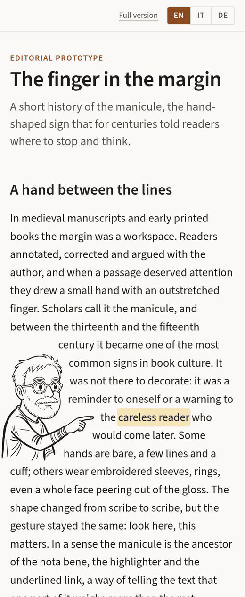

# Manicula

Illustrated maniculae (☞, the pointing hands of medieval margins) for the web. Each figure hangs
into the page margin and points at a marked word, and the text flows around the figure's real
outline, line by line. The layout is recomputed live with [Pretext](https://github.com/chenglou/pretext).


It is a self-contained prototype: every page is a single HTML file with no framework and no build
step at runtime. Open `index.html` in a browser, or see the live demo:
**[franzmozzi.github.io/manicula](https://franzmozzi.github.io/manicula/)**.

## Pages

Each link opens the live page.

| | Full (with controls) | Barebone |
|---|---|---|
| English (default) | [`index.html`](https://franzmozzi.github.io/manicula/index.html) | [`barebone.html`](https://franzmozzi.github.io/manicula/barebone.html) |
| Italiano | [`it/index.html`](https://franzmozzi.github.io/manicula/it/index.html) | [`it/barebone.html`](https://franzmozzi.github.io/manicula/it/barebone.html) |
| Deutsch | [`de/index.html`](https://franzmozzi.github.io/manicula/de/index.html) | [`de/barebone.html`](https://franzmozzi.github.io/manicula/de/barebone.html) |

- **Full** has a control bar for experimenting live. You can change each block's target, the
  column width, the figure size and the finger gap, and show the traced outline. A status line
  under each block reports how well the finger lines up with its target.
- **Barebone** has only the article, with the defaults hard-coded in the stylesheet. Size and
  spacing change only through the attributes of each block's mark.
- The bar of each page links to the same variant in the other languages and to the other variant.

## How it works

1. **Outline.** Each figure is an inline SVG. On load it is drawn to a canvas, and its alpha
   channel gives the figure's horizontal extent for every pixel row. The fingertip is the point
   that reaches furthest toward the text.
2. **Line by line.** Pretext breaks the text one line at a time. Each line gets the width that is
   left beside the figure's outline at that height, minus a small gap, so it never touches the
   ink. The part of the figure that hangs into the margin takes no width from the text.
3. **Aiming.** The figure moves vertically until the fingertip sits on the middle of the line
   that holds the marked words. Moving the figure changes the line breaks, so this is repeated
   until it converges. If the target line keeps jumping between two positions, a line break is
   forced just before the marked words, as a compositor would do.
4. **Reflow.** A `ResizeObserver`, the font loading and the 820 px breakpoint trigger a new
   layout. Below 820 px the figures shrink and hang less into the margin.

<p align="center">
  
  &nbsp;
  
</p>

*Left: "Show outline" on the full page draws the traced outline, the fingertip and the line boxes.
Right: the barebone page at phone width.*

## Markup

Mark the spot directly in the text. Each block contains exactly one element with
`data-manicula`:

```html
<section class="manicula-block">
  <h2>A hand between the lines</h2>
  <p>… a warning to the <mark data-manicula>careless reader</mark> who …</p>
</section>
```

- Put it on a `<mark>` around the words to point at. The figure points at exactly that
  occurrence, even if the same words appear again in the paragraph.
- In a list, put it on the whole entry: `<li data-manicula>`.
- The paragraph can sit inside a `<blockquote>`. The text keeps the quotation's size and
  leading.

| Attribute | Values | Default |
|---|---|---|
| `data-side` | `left`, `right` (also `sx`, `dx`) | opposite of the previous block, starting on the left |
| `data-scale` | figure size in %, 25–200 | 100 |
| `data-gap` | px between fingertip and text, 0–60 | 14 (10 below 820 px) |
| `data-bleed` | px the figure hangs into the margin, 0 up to the page bleed | 85 (15 below 820 px) |

Out-of-range values are clamped. `data-bleed` can only pull a figure inward, so a figure never
leaves the viewport on a phone. On the full page, the "Maniculae" slider multiplies
`data-scale`, and `data-gap` overrides the "Finger gap" slider for that block.

```html
<mark data-manicula data-side="right" data-scale="65" data-gap="24" data-bleed="40">where to look</mark>
```

The script generates everything else: the text column, the figure, the outline overlay and the
status line.

## Accessibility and SEO

- **Original text.** It stays in the DOM in its original element (`<p>`, `<ul>`, `<blockquote>`),
  only visually hidden, so screen readers and crawlers read normal text with its `<mark>`.
- **Visible lines.** They are absolutely positioned `<span>`s inside an `aria-hidden` container,
  and the figures are decorative.
- **Fallback.** Without JavaScript or network, each block is a plain paragraph with the words
  highlighted.
- **Languages.** Pages carry the correct `lang` and link their translations with `hreflang`.

## Dependencies

The pages load two external resources:

- [`@chenglou/pretext`](https://github.com/chenglou/pretext) `1.0.0` as an ES module from
  esm.sh. It does the line breaking; the pages use `prepareWithSegments`, `layoutNextLine` and
  `clearCache`.
- Source Sans 3 (400, 600) from Google Fonts.

For production, serve both from your own domain instead of the CDNs.

The browser needs ES modules, Canvas 2D, `ResizeObserver`, `document.fonts` and
`Intl.Segmenter`. Current Chrome, Edge, Firefox and Safari have all of them.

## Development

The pages are generated from `src/` and committed, so the repository can be served as is, for
example with GitHub Pages.

```
src/template.html        shared shell: styles, control bar, layout engine
src/content/<lang>.html  article, usage guide and target suggestions for one language
src/i18n/<lang>.json     UI labels and the status-line strings used by the script
src/svg/left.svg         the two figures
src/svg/right.svg
tools/build.py           src/ -> the six pages (list in PAGES)
tools/extract.py         tools/reference.png -> src/svg/*.svg (crop, drop surrounding text, trace)
tools/test/check.py      headless Chromium: drives controls and viewport, measures alignment
tools/test/sweep.py      tries every word and list entry as target at 375, 830 and 1280 px
```

The template holds placeholders: `{{CONTENT}}`, `{{t:key}}`, `{{STRINGS}}` and `{{SVG_LEFT}}` /
`{{SVG_RIGHT}}`. Parts that belong to one variant only are wrapped in `<!--full-->…<!--/full-->`
or `<!--bare-->…<!--/bare-->` in HTML, and in `/*full*/…/*/full*/` in CSS and JS.

```sh
python3 -m venv .venv
.venv/bin/pip install -r tools/requirements.txt

.venv/bin/python tools/build.py                 # rebuild all pages
.venv/bin/python tools/extract.py               # only when the figures change

# tests: need `chromium` on PATH
.venv/bin/python -I tools/test/check.py                              # index.html
.venv/bin/python -I tools/test/check.py "file://$PWD/de/barebone.html"
.venv/bin/python -I tools/test/sweep.py 100 it/index.html            # figure size %, page
```

On a barebone page `check.py` runs only the viewport steps, because there are no controls.

### Adding a language

1. Copy `src/content/en.html` and `src/i18n/en.json` to the new language code and translate
   them. Keep the block ids and one `data-manicula` per block.
2. Add the language and its two output paths to `PAGES` in `tools/build.py`.
3. Run the build, then `check.py` and `sweep.py` on the new pages.

## Known limitations

- Each block has one figure and one target.
- Large figures in narrow columns can leave no room beside the fingertip. The page then reports
  that the finger covers the whole column.
- In rare cases the finger lands one line off, for example with some list entries as target at
  phone width (`sweep.py` lists them).
- A target in the first lines of a block pushes the text down, because the figure cannot rise
  above the block.

## Credits

- Line breaking by [Pretext](https://github.com/chenglou/pretext) by Cheng Lou.
- Typeface: [Source Sans 3](https://fonts.google.com/specimen/Source+Sans+3) by Paul D. Hunt for
  Adobe.
- The figures were traced with [vtracer](https://github.com/visioncortex/vtracer) from the
  reference illustration in `tools/reference.png`.

## License

Released into the public domain under [the Unlicense](LICENSE): code, content, figures and
screenshots alike. The figures are caricatures of the author, who places them in the public
domain too. Pretext and Source Sans 3 are not part of this repository; they are loaded from
their CDNs under their own licenses (MIT and SIL Open Font License).
